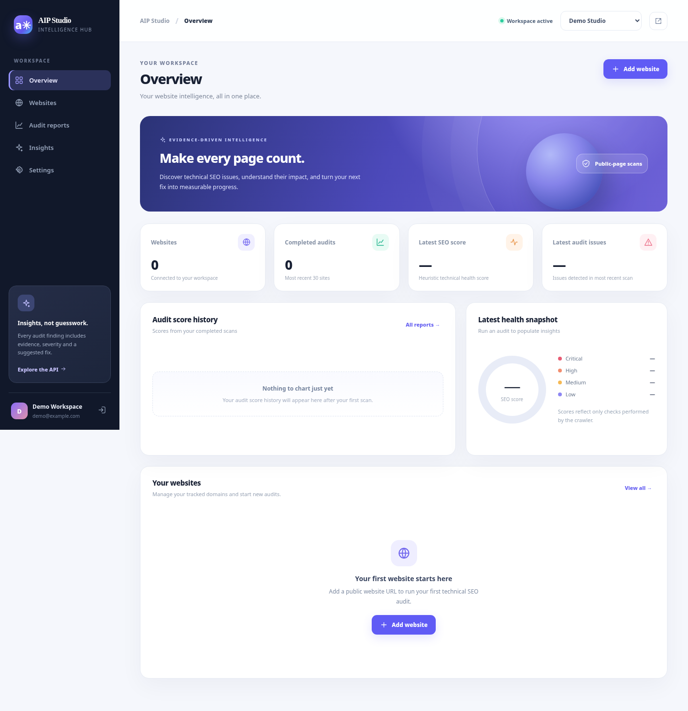
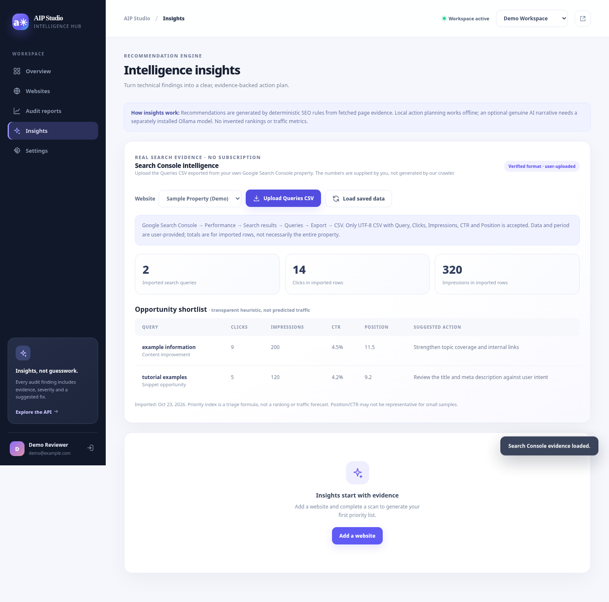

# AIP Studio — Autonomous Intelligence Platform

**Cost-free, self-hosted website intelligence with an elegant workspace and evidence-driven SEO analysis.**

A full-stack Python/FastAPI project with a browser dashboard, tenant-isolated accounts,
email confirmation and password recovery, a bounded public website crawler, a durable
scan queue and worker, technical and content SEO insights, manual Google Search Console
CSV evidence, and free local recommendations. An optional **locally installed Ollama
model** can produce generative SEO explanations without paid model APIs.

> **Truth in metrics:** The SEO score is an AIP heuristic, **not** Google's score,
> PageSpeed, search ranking, impressions, traffic or Core Web Vitals. A failed scan
> displays **N/A**, not a plausible invented score. GSC metrics are available only
> when you **upload an export** from your own property.





The screenshots are interface demonstrations and should be labeled as such on LinkedIn.

## Core features

| Area | Implemented capability |
|---|---|
| Authentication | Registration, six-digit email verification, single-use recovery codes, password changes, JWT access + rotating tracked refresh tokens |
| Workspaces | Membership-based organization access, isolation between users/organizations |
| Crawling | Up to **15** same-host public HTML pages, validated/pinned public DNS, redirect limits, verified `robots.txt`, optional sitemap discovery |
| Technical SEO | Status, indexability hints, title/description, canonical, headings, image alt, viewport, language, JSON-LD syntax/type observations, response timing, Open Graph, HSTS diagnostics |
| Content | Observed on-page terms and phrases in English/Persian/Arabic, page-by-page metadata, internal/external links, thin-content/duplicate-title/overlapping-intent opportunities |
| Search evidence | Upload your **Google Search Console Queries CSV** (including supported Persian/Arabic headers) to examine **actual exported** clicks, impressions, CTR and average positions, with a transparent editorial-priority heuristic |
| Reports | Evidence and proposed fixes, severity filtering, scan history, CSV export, misleading historical scores normalized |
| Local intelligence | Reproducible, explainable priority action plan without subscription or internet AI API; optional genuine generative reasoning through **Ollama** installed locally |
| Platform | FastAPI, SQLAlchemy, Alembic migrations, SQLite for local dev, optional PostgreSQL, persisted queue with a dedicated scan worker, Docker Compose, request IDs, secure response headers, tests and GitHub Actions |

### Quick start on Windows — Python 3.12 or 3.13

1. Unzip into a **new** folder called `AIP-Studio-Final` (do not overwrite your previous `AIP-Studio` folder).
2. Open `AIP-Studio-Final` in VS Code, then launch PowerShell from that folder.
3. Start the app:

```powershell
powershell.exe -NoProfile -ExecutionPolicy Bypass -File .\start-windows.ps1
```

The starter creates `backend/.venv` as needed, installs Python dependencies,
creates a **local `.env` with a generated secret** if absent, applies migrations,
starts a background scan worker, then runs the web API.

- Dashboard: **http://localhost:8000/**
- Swagger: **http://localhost:8000/docs**
- Worker troubleshooting: `worker.stdout.log`, `worker.stderr.log`

The starter uses **Python 3**, including an installed Python 3.13, rather than
requiring Python 3.12 exactly. It uses the environment in `backend/.venv` if
already created.

### Preserve your previous account and workspace

**Back up** the existing `AIP-Studio` folder first. With the new folder installed
alongside the old folder, from the **new** `AIP-Studio-Final` directory, **before
starting the new server**, run:

```powershell
Copy-Item '..\AIP-Studio\.env' '.\.env'
Copy-Item '..\AIP-Studio\backend\platform.db' '.\backend\platform.db'
```

These commands presume your existing SQLite database is `backend/platform.db`.
If your original `.env` points to another location via `DATABASE_URL`, **use
that original location instead**. Do not copy a database while its old server
is writing to it; first shut down the old server and make a backup.

The Alembic upgrade adds `search_performance_imports` and `scan_jobs` while
retaining users, organizations, sites and audit history. Never publish `.env`,
`.db` or tokens to GitHub.

## How to use

1. Create account and workspace, then verify the six-digit code. In **local
   development**, the code appears in the server terminal (no email is sent).
2. For real email delivery, configure SMTP, see below.
3. **Websites → Add website** with a public domain you have permission to audit.
4. **Scan**: the API enqueues a job. A separate worker retrieves allowed pages
   and stores the result; the browser follows progress.
5. **Audit reports**: inspect source URLs, findings, severity, next actions,
   robots/sitemap discovery, headings, keyword themes and export CSV.
6. **Websites → GSC data**: optionally import your own Search Console CSV.
   **Insights** then shows measured query evidence and recommended priorities.
7. **Action plan / local AI** creates a free explainable plan from saved evidence.
   Set up Ollama if you want a real local language model for additional narratives.

### Real keyword performance without paid services

In Google Search Console, open **Performance → Search results → Queries → Export → CSV**.
This export typically contains columns `Query, Clicks, Impressions, CTR, Position`
(or supported localized variants). If your export is a ZIP containing multiple
CSV files, **unzip it and select the Queries CSV**. Import limit: **2 MB / 3,000
query rows** per file, and last 20 imports are retained per website.

The import provides observed exported values and a disclosed priority index
based on impressions/CTR/position. **The exported period, account ownership,
search demand and completeness cannot be verified by AIP**. No unapproved Google
API calls or query scraping occur. Demo-only sample:
[`docs/examples/demo-gsc-queries.csv`](docs/examples/demo-gsc-queries.csv).

### Free AI: two distinct modes

**Local evidence plan — default, works offline after scanning**

```dotenv
LLM_PROVIDER=local
```

This plan is deterministic logic based on audit issues, content opportunities
and optionally imported GSC query rows. It is **not** a trained language model.

**True generative AI using your own CPU/GPU — optional**

Install the open-source Ollama runtime separately, for example:

```powershell
ollama pull gemma3:1b
```

Then edit root `.env`:

```dotenv
LLM_PROVIDER=ollama
LLM_MODEL=gemma3:1b
```

Restart the application and ensure Ollama is running at
`http://127.0.0.1:11434`. A downloaded model requires disk space, compute and
possibly substantial RAM. There are **no paid API requests**, though the
machine/internet/electricity aren't literally free. LLM output must be checked.

### Email confirmation and password recovery

For tests on your own machine, `EMAIL_MODE=console` sends **nothing** to real
inboxes: find codes in the local running server terminal.

To deliver real email codes, configure `.env` (an eligible existing SMTP mailbox
may be free, subject to provider limits):

```dotenv
EMAIL_MODE=smtp
SMTP_HOST=smtp.gmail.com
SMTP_PORT=587
SMTP_SECURITY=starttls
SMTP_USER=your-address@gmail.com
SMTP_PASSWORD=YOUR_PROVIDER_APP_PASSWORD
SMTP_FROM=your-address@gmail.com
```

Use a provider-issued application password and **never share it**. Check
SPF/DKIM/DMARC for domains you own before public use.

## Running tests

```powershell
cd backend
.\.venv\Scripts\python.exe -m pytest -q
```

The suite covers email and authentication boundaries, organization isolation,
worker jobs, scanner safety, CSV validation, GSC permissions and report status.
The GitHub CI workflow installs **real pinned dependencies** and executes tests
on Python 3.12 (then validates frontend JavaScript syntax).

## Docker Compose (developer setup)

Set a new strong `POSTGRES_PASSWORD` and `SECRET_KEY` in `.env`, then:

```bash
docker compose up --build
```

The included Compose services are PostgreSQL, FastAPI and a background scan
worker. The HTTP port is bound to `127.0.0.1:8000` for local-only access. **This
is not an automatically hardened public deployment**.

## Architecture

```text
Browser (dependency-free HTML/CSS/JS)
  │ session JWT; tenant-aware actions
  ▼
FastAPI /api/v1
  ├─ Auth, email OTP, organization roles
  ├─ Website CRUD, job enqueue + poll
  ├─ GSC CSV import + deterministic query triage
  └─ Audit summaries, CSV export, local evidence / Ollama narration
       │                            ▲
       ▼                            │
  SQLAlchemy + Alembic       scan worker process
       │                            │
       └── persisted jobs → bounded SSRF-aware crawler → stored audit + findings
```

Additional design notes in [docs/ARCHITECTURE.md](docs/ARCHITECTURE.md)
and [SECURITY.md](SECURITY.md).

## Explicit limitations / release gates

- **No automatic paid services** or secret API keys required for local operation.
  Hosting a publicly accessible website, domain name, SMTP and electricity may
  still entail real-world costs.
- Scans sample up to **15 HTML pages on a single configured hostname** (no
  JavaScript rendering), not a complete audit of unlimited pages. Canonical
  redirects to another hostname are flagged; register the destination separately.
- No live GSC OAuth sync, GA4 connection, backlink index, competitive SERPs,
  true keyword search volume, PageSpeed lab results or Core Web Vitals.
- SEO scoring is **heuristic**; failed scans show `N/A`. Observed response time
  is one measurement, not PageSpeed data.
- AIP's scan queue is durable; a crashed worker can leave a running job until
  stale detection marks it failed. Only one local worker is recommended.
- Before exposing to real public users, set up HTTPS/reverse proxy, production
  PostgreSQL and SMTP, edge IP-based quotas, backups, outbound egress firewall,
  monitoring, privacy/terms policies, and an independent security review.
  The code **does not warrant production security** without those measures.

## License

MIT, see [LICENSE](LICENSE).
